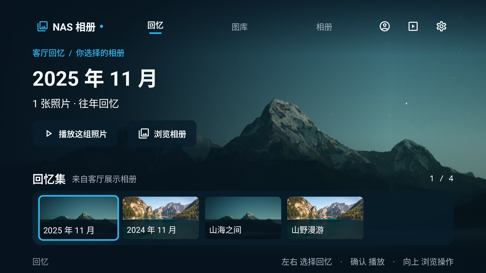
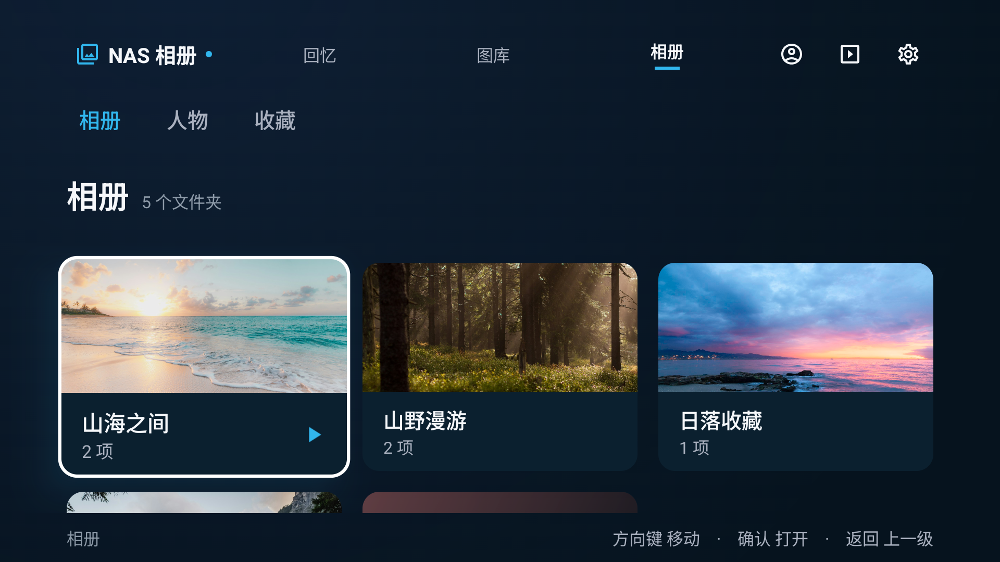
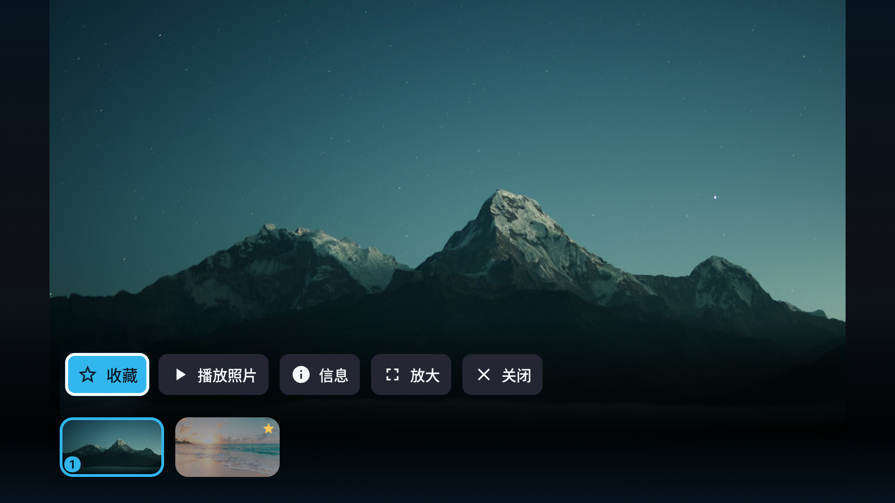
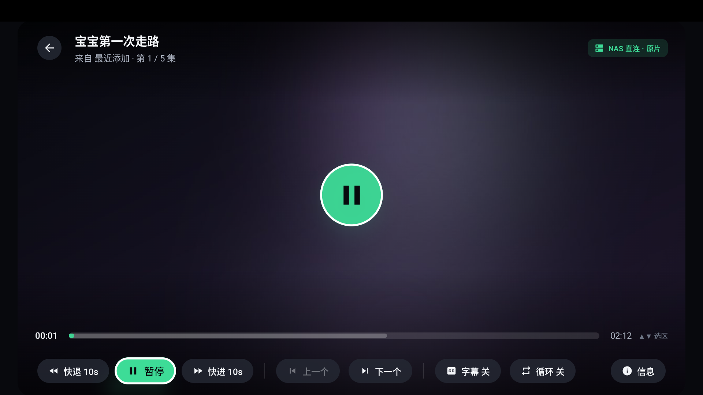
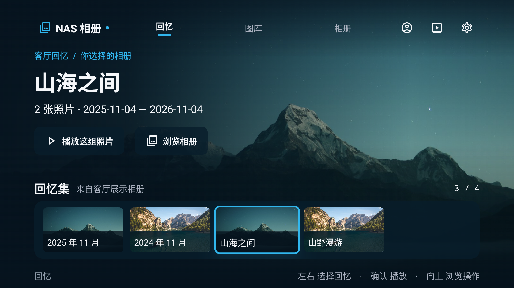
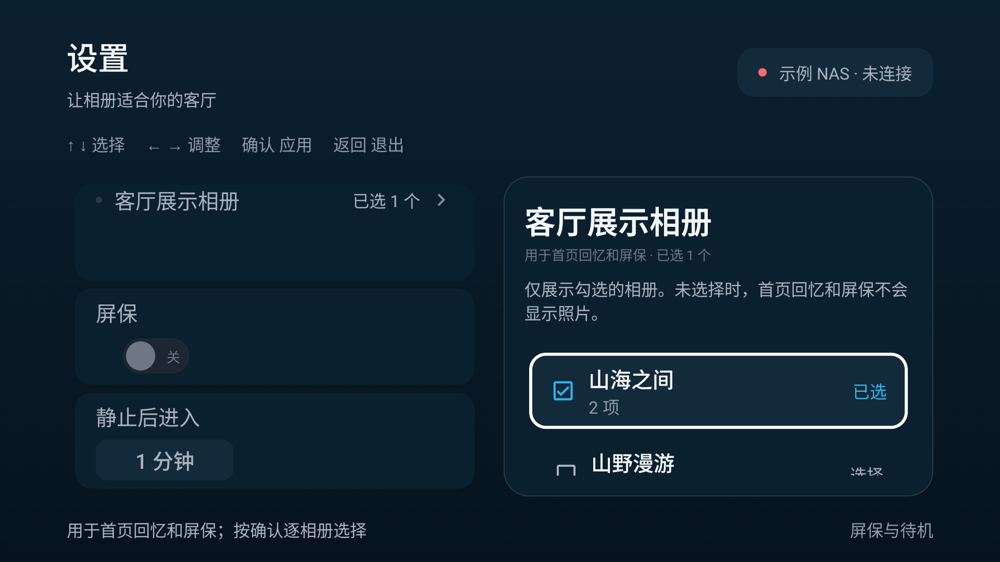
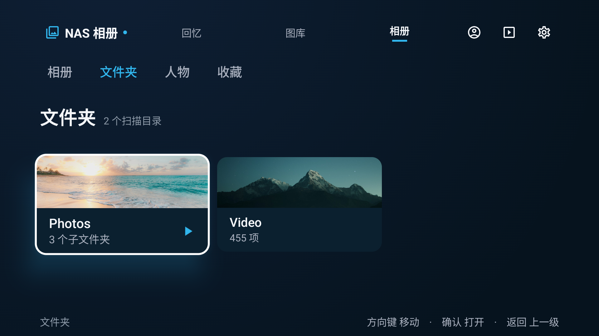

# NAS Photo TV

> **在电视上看 NAS 里的照片与视频，并把电视变成一台会呼吸的电子相框。**

Android TV 客户端（Kotlin + Jetpack Compose，单 Activity、纯 Compose）。数据来自真实飞牛 fnOS 相册：
局域网自动发现、WSS 加密登录、签名 HTTP、AccessToken 串流原片；屏保对标 iPhone StandBy ——
大号时钟、照片氛围、防烧屏。另有原生 tvOS 版本，见 [apple/README.md](apple/README.md)。

- 当前版本：Android `1.2.15`（versionCode 21） / tvOS 开发版 `1.2.15`（build 21）
- 技术栈：Kotlin 2.0.21 / AGP 8.7.3 / Compose BOM 2024.12.01 / Media3 1.5.1 / Coil 2.7.0 / OkHttp 4.12.0
- 兼容范围：minSdk 24（Android 7.0）、targetSdk 34、compileSdk 35；`java.time` 通过脱糖支持
- 仓库：[github.com/SMTM-PH/NasPhotoTV](https://github.com/SMTM-PH/NasPhotoTV)

## 开源协议

本项目采用 [Apache License 2.0](LICENSE)，版权与第三方素材说明见 [NOTICE](NOTICE)。
示例照片、依赖库与工具各自遵循其原有许可。

---

## 快速开始

```bash
# 1. 构建（Windows 用 gradlew.bat）
./gradlew :app:assembleDebug

# 2. 安装到已连接的电视 / 模拟器
adb install -r app/build/outputs/apk/debug/app-debug.apk

# 3. 启动
adb shell am start -n com.nasphoto.tv/.MainActivity
```

也可以从 [GitHub Releases](https://github.com/SMTM-PH/NasPhotoTV/releases) 下载正式签名 APK。

首次启动会进入连接页：自动扫描局域网里的飞牛 NAS，也可手动填写地址、端口、账号、密码和访问码。
连接成功后先显示首页，再在后台补齐完整时间线、相册、人物与文件夹数据。

### 外网访问 / 反向代理

设置页「地址」既接受 `IP` / 域名，也接受完整 URL：

```
192.168.31.8                          # 局域网直连，HTTPS 5667
https://nas.example.com               # DDNS 域名直连
http://relay.example.com:8080/nas     # HTTP 中转 + 子路径 /nas
https://relay.example.com/nas/        # HTTPS 443 中转 + 子路径 /nas
```

协议、主机、端口、子路径分别保存，API / 图片 / WebSocket 请求都会挂到子路径下
（如 `/nas/p/api/v1/...`、`/nas/websocket?type=main`）；`http` 下 WebSocket 自动降级为 `ws`。

> 反向代理需要剥掉子路径前缀再转发给飞牛 Web 服务（如 Nginx
> `location /nas/ { proxy_pass https://NAS_IP:5667/; }`）。`authx` 签名基于飞牛内部
> `/p/api/...` 原路径，前缀不参与签名。局域网自动发现选中的设备会重置为直连 / 根路径。

---

## 功能概览

### 媒体库 · 浏览

顶栏包含首页状态（连接名 + 在线/离线/连接中）、多个 Tab、艺术画册入口，以及屏保、手机传图、设置按钮。
主 Tab 由 `LibraryTab` 定义：

| Tab | 内容 |
|---|---|
| 回忆 | 沉浸式首页；照片 Hero + 横排内容；可进入「智能分类」瀑布流浏览 AI 事物 / 场景分类 |
| 图库 | 按年 → 月 → 日逐级下钻的时间线网格 |
| 相册 | 相册网格与相册详情；相册可单独设置放映参数 |
| 文件夹 | 读取飞牛文件夹视图，逐级浏览根目录 / 子目录 / 孙目录 |
| 人物 | NAS 人脸聚类；未开启 AI 相册时显示空状态 |
| 最近拍摄 | 时间倒序的媒体网格 |
| 收藏 | 飞牛收藏 ∪ NAS `isCollect` ∪ 本机星标 |
| 地点 | 读取飞牛地图聚合数据按区域浏览，附离线城市名索引 |

相册详情、人物详情、某一天的照片、收藏网格共用媒体网格；各层级都有加载态和空状态。

### 看图 · 放映

- 全屏看图：图片优先铺满舞台，标题 / 来源 / 拍摄日期 / 序号是 3 秒自动隐藏的浮层；LIVE 徽标常驻。
- 工具：上一张 / 下一张（循环）、信息、收藏、幻灯片、2× 放大与方向键平移、关闭；底部胶片条。
- 放映：每个相册可单独保存停留时间（3–30 秒）、换片效果、背景音乐与相框，设置页可预览动效。
- 背景音乐：手机经局域网网页上传音频，存在 App 私有目录并循环播放。
- 视频项在看图列表里显示封面和播放标记，确认后交给播放器。

### 视频播放

- Media3 ExoPlayer + 带 AccessToken 的 OkHttp 数据源，直接串流 NAS 原片。
- 控制层 3 秒自动隐藏；播放 / 暂停、进度、±10 秒快进快退、媒体键上一集 / 下一集、自动连播与循环。
- 竖屏画面适配（自动填充 / 完整画面 / 铺满屏幕）与画面旋转（0° / 90° / 180° / 270°），播放中也可临时切换。
- 解码能力探测与播放缓冲计划；解码失败显示具体原因，并可跳到下一条。

### 屏保待机

- 三种画面：时钟待机 / 纯照片 / 照片墙；客厅展示相册需逐相册授权。
- 五种时钟：巨幕时钟、翻页数字、纤细极简、极简小钟、日期日历；中文日期与近似农历小字。
- 三种时钟背景：照片轮播 / 极光动态 / 纯黑极简；照片来源可选人物、最近、随机或指定相册。
- 防烧屏：像素位移、夜间呼吸调暗、Ken Burns 缓慢推拉、压暗遮罩；任意键退出且首次按键只退出。
- 进入方式：顶栏屏保按钮、设置页预览、空闲超时自动进入；看图 / 播放中不自动进入。

### 手机传图

顶栏「传图」打开局域网网页上传页，手机与电视同网段即可传照片；可选把照片备份回当前 NAS 账号。
上传地址只在本地显示，照片不经过第三方服务器。

### 设置

两栏布局，左栏 7 组共 42 项，右栏随聚焦项切换预览或详情：

| 分组 | 内容 |
|---|---|
| 外观 | 外观模式：跟随系统 / 浅色 / 深色，含两套配色的实时迷你预览 |
| NAS | 名称、地址、端口、账号、密码、访问码、测试连接、刷新媒体库 |
| 账号 | 当前账号左右键秒切、备注名、添加账号、删除账号 |
| 屏保 | 展示相册、开关、进入时间、画面 / 来源 / 相册、停留、时钟、背景、日期、夜间调暗、推拉、预览 |
| 放映 | 幻灯片停留、换片动效、背景音乐 |
| 视频 | 自动连播、循环、竖屏画面、画面旋转 |
| 关于 | 版本、引擎、设备、设计说明、恢复默认、在线更新及更新源配置 |

任何一项改完立即写入 SharedPreferences；「测试连接」是真实 WSS 登录 + 签名请求，失败会显示原因。
「在线更新」按确认逐步执行 检查 → 下载 → 安装，支持自定义更新源和镜像前缀。

### 外观模式

提供「影院黑」和「画廊白」两套外观，默认深色；看图、视频播放、屏保和艺术画册始终固定暗场，
照片才是主角。设计规则与 token 见 [docs/appearance/README.md](docs/appearance/README.md)，
可交互视觉稿见 [docs/appearance/preview.html](docs/appearance/preview.html)。

---

## 截图

| 回忆首页 | 相册页面 |
|---|---|
|  |  |

| 看图 · 按需浮层 | 视频播放 |
|---|---|
|  |  |

| 相册集合详情 | 客厅展示相册授权 |
|---|---|
|  |  |

| 屏保 · 巨幕时钟 | 文件夹浏览 |
|---|---|
|  |  |

> 其中 5 张为应用实际渲染的离线设计预览（相册、日期与分组为示例数据），另外 3 张来自连接真实 NAS 的
> Android TV 模拟器实测。图片拍摄时间早于当前版本，最新布局以代码与上文描述为准。
> 更多截图（视频旋转、Android 7 兼容、格式兼容等）在 [docs/screenshots/](docs/screenshots/)，
> 设计预览原图在 [docs/promotion/design-preview-20261105/images/](docs/promotion/design-preview-20261105/images/)。

---

## 构建与安装

### 环境

| 项 | 要求 |
|---|---|
| JDK | 17（工程 `sourceCompatibility` / `jvmTarget` = 17） |
| Gradle | 仓库自带 Wrapper 8.10.2 |
| Android SDK | compileSdk 35，build-tools 35.0.0；路径写在 `local.properties` 的 `sdk.dir` |
| 设备 | Android 7.0（API 24）+ 的 Android TV / Google TV / 电视盒子；leanback 与触摸屏均为可选 |

```bash
./gradlew :app:assembleDebug          # Debug APK
./gradlew :app:compileDebugKotlin     # 只验证编译
./gradlew :app:assembleRelease        # Release（无正式 keystore 时回退 debug 签名）
```

产物：`app/build/outputs/apk/debug/app-debug.apk`、`app/build/outputs/apk/release/app-release.apk`。
内存受限的机器可加 `--no-daemon --no-parallel -Dorg.gradle.jvmargs="-Xmx1536m -XX:MaxMetaspaceSize=512m"`。
同一时间只跑一个 Gradle，避免构建目录冲突。

### 安装与调试

```bash
adb connect 192.168.1.50:5555         # 电视需开启 ADB 调试
adb install -r app/build/outputs/apk/debug/app-debug.apk
adb shell am start -n com.nasphoto.tv/.MainActivity
adb logcat -s AndroidRuntime:E        # 看崩溃日志
```

也可以用 U 盘 + 电视文件管理器安装，需允许安装未知来源应用。

### 模拟器 / 无头运行

工程自带多个 `@Preview(widthDp = 1920, heightDp = 1080)`，在 Android Studio 里可直接查看。
推荐 Android TV 镜像（如 `system-images;android-36;android-tv;x86_64`），`tv_1080p` 设备模板；
验证低版本兼容可用 `system-images;android-24;android-tv;x86`。

无显示器的服务器上跑 TV 镜像时，下面几个参数缺一可能导致周期性 SIGSEGV：

```bash
emulator -avd tv36 -no-window -no-audio -no-snapshot \
  -gpu swangle_indirect \
  -feature -ModemSimulator \
  -timezone Asia/Shanghai \
  -cores 2 -memory 1536
# Docker 容器还需 --shm-size=2g
```

---

## 遥控器操作

| 键 | 通用行为 |
|---|---|
| `DPAD_UP/DOWN/LEFT/RIGHT` | 移动焦点；行内左右、跨行上下由页面显式接管 |
| `DPAD_CENTER` / `ENTER` | 确认 |
| `BACK` | 返回上一级；看图 / 播放 / 设置页内为关闭 |
| 长按 / 双击 / 手势 | 不支持 |

- **媒体库**：Tab 左右移动，`DOWN` 进入内容；`LEFT/RIGHT` 在横排或网格内移动，`UP/DOWN` 跨行；
  相册、人物详情里 `BACK` 回列表。
- **看图**：`LEFT/RIGHT` 切上一张 / 下一张；`UP` 展开详细信息；`DOWN` 进入工具行；
  `ENTER` 切换控制栏；媒体键 `PLAY/PAUSE` 控制幻灯片；`BACK` 关闭。
- **播放器**：`UP/DOWN` 唤出 / 隐藏控制层；`LEFT/RIGHT` ±10 秒；`ENTER` 播放 / 暂停；
  媒体键切上一集 / 下一集；`MENU` 临时旋转画面；`BACK` 关闭。
- **屏保**：任意键退出，第一次按键只退出，不触发下层页面动作。
- **设置**：`UP/DOWN` 移动行；`LEFT/RIGHT` 调值（账号行可直接切换）；`ENTER` 执行动作或打开输入层；`BACK` 关闭。

---

## 目录结构

```
<仓库根目录>
├─ README.md / LICENSE / NOTICE / CONTRACT.md / DESIGN.md
├─ docs/
│  ├─ acceptance.md                  验收清单
│  ├─ appearance/                    浅色 / 深色外观设计与 token、视觉稿
│  ├─ screenshots/                   实测截图
│  └─ releases/                      各版本发布说明
├─ apple/NasPhotoTV/                 tvOS 客户端（SwiftUI）
├─ media_samples/                    示例图片素材
├─ tools/gen_assets.py               素材生成脚本（需 Pillow）
└─ app/src/main/
   ├─ AndroidManifest.xml            单 Activity、双启动入口、leanback 可选
   ├─ java/com/nasphoto/tv/
   │  ├─ MainActivity.kt             沉浸式全屏 + 全局按键时间戳
   │  ├─ ui/
   │  │  ├─ NasPhotoTvApp.kt         路由 / 外壳 / 空闲屏保 / 页面切换
   │  │  ├─ TvContract.kt            AppRoute、LibraryState、请求模型
   │  │  ├─ theme/                   TvColor / TvDimen / TvType、Appearance、M3 主题、焦点环
   │  │  ├─ common/                  媒体加载、焦点卡、空闲守卫、幻灯片音乐
   │  │  ├─ connection/              首次连接页与手动配置表单
   │  │  ├─ library/                 首页 / 时间线 / 相册 / 文件夹 / 人物 / 地点 / 收藏
   │  │  ├─ viewer/                  看图、信息浮层、工具条、换片效果
   │  │  ├─ video/                   播放器、解码能力探测、缓冲计划
   │  │  ├─ screensaver/             屏保入口、时钟、背景、照片墙、状态工具
   │  │  ├─ settings/                设置页、7 组设置行与各右栏面板
   │  │  ├─ transfer/                手机传图页
   │  │  └─ book/                    艺术画册
   │  └─ data/
   │     ├─ fn/                      飞牛登录 / 签名 / 传输 / TOFU / 局域网发现
   │     ├─ model/                   数据模型
   │     └─ ...                      仓库、缓存、收藏、设置、放映、地图、上传、更新等
   └─ res/                           主题、字符串、图标、横幅、放映预览图
```

---

## NAS 接入

| 能力 | 位置 | 说明 |
|---|---|---|
| 局域网自动发现 | `data/fn/LanNasDiscovery.kt` | 扫描本机 /24 网段的 5667 端口，按 TLS 证书识别飞牛设备 |
| WSS 加密登录 | `data/fn/FnOsApi.kt` | RSA 公钥 + AES-CBC 加密凭据，换取 AccessToken |
| 签名 HTTP | `data/fn/FnOsSigner.kt` 等 | 业务请求带 `authx` 签名与递增 reqid |
| TOFU 证书信任 | `data/fn/FnOsTofu.kt` | 首次证书指纹落盘，变化时提示 |
| Token 注入 | `data/fn/FnOsTransport.kt` | OkHttp 拦截器统一注入；Coil 图片与 ExoPlayer 共用客户端 |
| 相册与时间线 | `data/FnOsMediaRepository.kt` | 时间线、相册、共享相册、原片串流 |
| 文件夹 / 人物 / 地点 | `FnOsFolders.kt` `FnOsSmartAlbums.kt` `FnOsMapPlaces.kt` | 分层目录、人脸聚类、地图聚合与按区域分页 |
| 多账号 | `data/SettingsStore.kt` | 同一台 NAS 多账号切换；切号重建仓库、清缓存、重载收藏 |
| 在线更新 | `data/AppUpdate.kt` | GitHub latest API（可换镜像），手动确认下载与安装 |

---

## 已知限制

- **视频解码依赖设备能力**：4K / 10bit / 高帧率原片可能超出电视解码能力；已提供错误提示与「下一曲」跳过，但没有自动转码或降级选流。
- **不解析字幕文件**：没有 `.srt` / `.ass` 字幕支持。
- **无搜索输入界面**：没有电视端键盘搜索页；目录浏览与时间线是主要检索方式。
- **屏保是 App 内页面**：未实现系统级 `DreamService`，不能由系统待机直接唤起。
- **仅支持同一台 NAS 的多账号**：跨多台 NAS 的家庭共享需要设备授权与权限模型，尚未实现。
- **收藏只存本机**：按账号分区保存在 SharedPreferences，不写回 NAS、不跨设备同步。
- **农历为近似值**：年干支准确，农历日期使用内置锚点推算，远日期可能有偏差。
- **部分格式依赖系统 / NAS 兼容**：HEIC、等特殊格式在低版本 Android 上依赖系统解码器或 NAS 生成的预览。
- **4K 面板未完整实测**：布局按 1920×1080 设计，高密度屏幕经归一化适配，性能与画质未做全机型验收。

---

## 相关文档

| 文档 | 内容 |
|---|---|
| [CONTRACT.md](CONTRACT.md) | 团队协作契约：公共文件、遥控器交互、编译约定 |
| [DESIGN.md](DESIGN.md) | 设计规范：token、布局、焦点、屏保、动效、可访问性 |
| [docs/acceptance.md](docs/acceptance.md) | 按页面列出的验收清单 |
| [docs/appearance/](docs/appearance/) | 浅色 / 深色外观规范、token 导出与交互视觉稿 |
| [apple/README.md](apple/README.md) | tvOS 版本构建、签名与分发说明 |
| [docs/releases/](docs/releases/) | 历史发布说明 |
| [tools/gen_assets.py](tools/gen_assets.py) | 示例素材生成脚本 |
