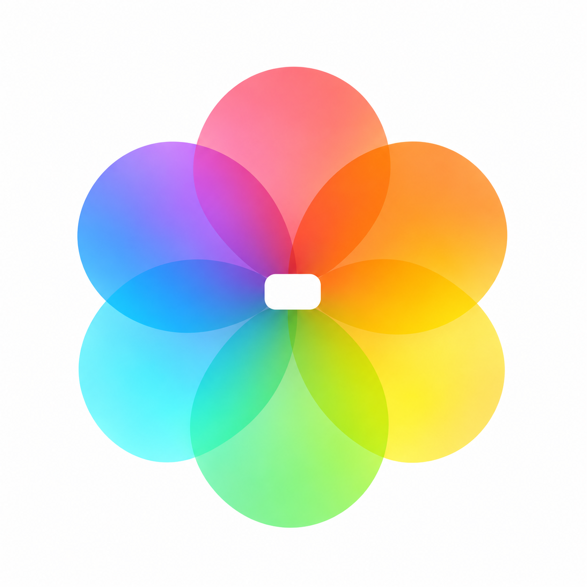

# NAS Photo TV · App 图标设计

## v2 · 彩色相册花

2026-11-05，按「参考苹果相册图标」调整。由内置 imagegen 生成和细化，原图为 1254×1254 RGB PNG。

参考[苹果官方图标设计示例](https://developer.apple.com/design/human-interface-guidelines/app-icons)的简洁构图与彩色叠层。六瓣宽圆角花瓣形成完整花形，白底与半透明叠色突出相册属性；中心小块横向留白含蓄表达大屏窗口，保留冰青色与当前应用的联系。

新稿独立保存；现有应用资源和 APK 没有替换。生成与细化提示词见 [prompt-v2.md](prompt-v2.md)。

## v1 · 电视与叠放相片

2026-11-05，方案 v1。由内置 imagegen 生成，原图为 1254×1254 RGB PNG。

用叠放相片表达相册，前景照片框与电视底座组成大屏观看符号。深海蓝背景、冰蓝主体及少量柔白色，与当前应用界面配色保持一致。无文字，避免小尺寸启动图标出现难读的标签。

本文件夹为独立设计交付；现有应用图标和电视横幅没有替换，APK 没有重建。后续接入时需要另导出相应尺寸，并检查系统遮罩与电视桌面横幅。

原始生成提示词见 [prompt.md](prompt.md)。
