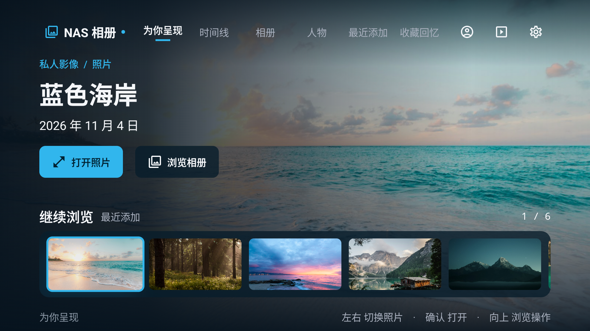
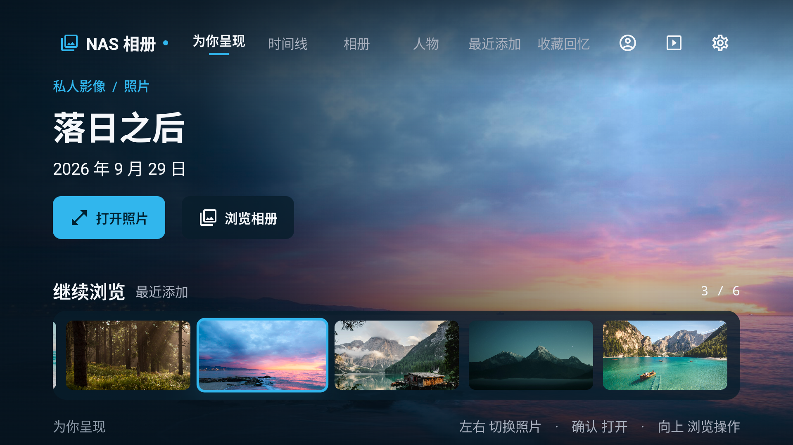

# NAS Photo TV · 沉浸式影像首页

2026-11-04 · 基于 `b1f8df2`（1.1.2）的界面改版。

> 本文是中间一版首页的历史记录。最新三项导航、回忆集合与展示范围见 [2026-11-05 相册体验整改](../design-refinement-20261105/README.md)。下文的六类内容导航与最近照片胶片条描述只对应当时实现。

本轮参考用户提供的界面截图，采用「全屏背景 + 左侧信息与操作 + 底部横向胶片条」的构图，应用到私人 NAS 相册。此版本替代[上一版客厅影廊](../design-next/README.md)的首页布局；上一版记录与截图保留，便于对照。

当前界面已完成 Debug 构建，并在 960×540 dp 通用 Android 模拟器上确认缩略图切换同步背景、标题与日期，以及打开当前照片后返回恢复选中项。其他验证边界见 [本轮记录](qa/verification.md)。正式 NAS 连接、账号、分页、看图、视频与屏保数据流继续沿用。

## 原生预览





## 首页构图

首页照片铺满整个画面，延伸到导航栏与正文下方。左侧深色渐变为标题、日期和操作提供稳定对比度；上、下边缘遮罩承托导航与胶片条。

```text
┌─────────────────────────────────────────────────────────────────────────┐
│ NAS 相册  为你呈现  时间线  相册  人物  最近添加  收藏回忆   账号 屏保 设置 │
│                                                                         │
│ 私人影像 / 照片                                                         │
│ 照片标题                                                                │
│ 拍摄日期                            全屏照片背景                         │
│ 把这一刻，留在大屏上                                                     │
│ [打开照片]  [浏览相册]                                                   │
│                                                                         │
│ 继续浏览  最近添加                                               1 / N  │
│ ┌─────────────────────────────────────────────────────────────────────┐ │
│ │ [缩略图]    [缩略图]    [缩略图]    [缩略图]    [缩略图]  →           │ │
│ └─────────────────────────────────────────────────────────────────────┘ │
│ 为你呈现                左右 切换照片 · 确认 打开 · 向上 浏览操作         │
└─────────────────────────────────────────────────────────────────────────┘
```

导航保持六类内容，以冰蓝短线标记已选择页面。左侧标识可返回首页；右侧保留账号、屏保和设置入口，账号未加载时收起账号图标。背景只是展示层，不参与焦点移动。

底部胶片条以五张缩略图的宽度分配空间，使用横向懒加载列表承载更多内容。首页优先展示最近添加的最多 24 项；最近列表为空时，回退到已加载图库的前 24 项。聚焦缩略图会同步当前媒体 ID，使背景、标题、日期和主操作指向同一项；移动焦点本身不会打开看图页。

照片的主操作为「打开照片」，视频为「播放视频」；第二个操作「浏览相册」切换到相册页。视频缩略图保留时长标识。胶片条标题右侧显示当前序号与项目总数。

## 颜色与密度

| 角色 | 当前实现 |
| --- | --- |
| 基础背景 | 深海蓝 `#06131E` |
| 照片舞台 | `#0B202F` |
| 功能表面 | `#122A3A` |
| 胶片条与次要操作 | 半透明深蓝 `#CC081D2B` |
| 主操作、选中标记、缩略图焦点 | 冰蓝 `#31B6ED` |
| 主文字 / 次文字 | `#F5F7FA` / `#A9B0BE` |
| 主操作文字 | 深色 `#002232` |
| 字体 | Android 系统无衬线中文，主标题加粗，序号等宽 |

以下为源码中的布局值；960×540 dp 已截取实际界面，其他画布本轮尚未运行核对。`dp` 是逻辑尺寸；实际像素大小取决于设备密度。

| 项目 | 1920×1080 dp | 960×540 dp |
| --- | --- | --- |
| 布局分支 | 宽布局 | 宽度小于 1500 dp 或可用高度小于 720 dp 的紧凑布局 |
| 左右安全边距 | 64 dp | 64 dp |
| 导航控件高度 | 48 dp | 48 dp |
| 标题字号 | 84 sp，最多两行 | 40 sp，单行省略 |
| 左侧信息区域 | 画面宽度的 55% | 画面宽度的 62% |
| 辅助句「把这一刻，留在大屏上」 | 显示 | 收起 |
| 主操作高度 | 52 dp | 52 dp |
| 五列缩略图宽度 | 约 342 dp | 约 150 dp |
| 缩略图高度 | 宽度的 56%，约 192 dp | 宽度的 56%，约 84 dp |

中等画布（如 1280×720 dp）也使用紧凑布局并将标题限制为单行；宽度达到 1200 dp 时标题使用 56 sp，避免两行大标题侵占胶片条。

缩略图聚焦时放大至 1.04 倍，使用冰蓝描边；主操作与导航使用 1.025 倍放大。焦点描边宽度为 3 dp。当前媒体即使不在焦点上，仍有较细的选中边框，使「当前展示」与「正在操作」可以分别辨认。背景切换使用 280 ms 淡入淡出。

## 遥控器操作

| 所在区域 | 方向键 | 确认 | 返回 |
| --- | --- | --- | --- |
| 首页胶片条 | 左右移动并更新大背景；向上到主操作 | 打开当前照片或播放视频 | 交给 App 外层返回逻辑 |
| 首页两项操作 | 左右切换操作；向上回当前导航；向下回当前缩略图 | 执行对应操作 | 交给 App 外层返回逻辑 |
| 顶部内容导航 | 左右移动；向下进入当前内容区 | 切换页面 | 非首页内容页先回首页 |
| 左侧 NAS 标识 | 向下到当前内容导航 | 返回首页并关闭详情层 | 沿用所在页面返回逻辑 |
| 账号 / 屏保 / 设置 | 左右移动；屏保和设置向下到当前导航 | 分别打开设置、屏保或设置页 | 沿用所在页面返回逻辑 |
| 相册或人物详情 | 沿用已有列表与网格操作 | 打开选中内容 | 回上一层列表，并恢复对应列表焦点 |
| 时间线 | 沿用已有层级导航 | 进入选中年份、月份或照片 | 优先处理时间线内部层级 |

进入有近期照片的首页时，内容区初始落点是当前缩略图。选中媒体 ID 通过可保存状态保留；从看图页返回时，首页可据此恢复当前照片。恢复屏幕外的缩略图时，先滚动到可见区域，再请求焦点。照片切换只更新展示数据，不主动把焦点从操作按钮拉回胶片条。

当图库整体为空时，继续显示现有配置引导；没有可供首页展示的媒体、但仍有相册或人物数据时，首页提供「浏览相册」入口。

## 离线设计预览

Debug 专属入口使用本地摄影样例，在独立进程和独立偏好存储中运行。预览照片、日期、人物与 NAS 状态是示例数据；真实 NAS 内容通过正常 App 入口浏览。正式 Release 不包含预览入口和示例摄影资源。

在已构建并安装本轮 Debug 包的设备上启动：

```powershell
adb install -r app/build/outputs/apk/debug/app-debug.apk
adb shell am start -n com.nasphoto.tv/.DesignPreviewActivity
```

可直接进入相册页或其他预览画面：

```powershell
adb shell am start -n com.nasphoto.tv/.DesignPreviewActivity --ei tab 2
adb shell am start -n com.nasphoto.tv/.DesignPreviewActivity --es screen settings
adb shell am start -n com.nasphoto.tv/.DesignPreviewActivity --es screen viewer
adb shell am start -n com.nasphoto.tv/.DesignPreviewActivity --es screen screensaver
```

重新选择启动参数时，应先结束当前预览 Activity 再启动。摄影素材出处与许可见[设计预览摄影素材来源](../design-next/qa/image-sources.md)。本轮截图与验证边界见 [验证记录](qa/verification.md)。

## 实现入口

- [ImmersiveHome.kt](../../app/src/main/java/com/nasphoto/tv/ui/library/ImmersiveHome.kt)：全屏照片、信息与操作、胶片条、选中同步和首页焦点恢复。
- [GalleryChrome.kt](../../app/src/main/java/com/nasphoto/tv/ui/library/GalleryChrome.kt)：单行透明导航与底部遥控提示。
- [LibraryScreen.kt](../../app/src/main/java/com/nasphoto/tv/ui/library/LibraryScreen.kt)：首页媒体 ID、背景展示、页面切换与返回处理。
- [Tokens.kt](../../app/src/main/java/com/nasphoto/tv/ui/theme/Tokens.kt)：深海蓝与冰蓝配色、标题字号、导航和胶片条尺寸。
- [DesignPreviewActivity.kt](../../app/src/debug/java/com/nasphoto/tv/DesignPreviewActivity.kt)：Debug 独立离线预览入口。

构建、通用 Android 模拟器核心交互已分别记录。1920/1280 dp、真电视与真实 NAS 本轮尚未验证；模拟器窗口已留给用户操作体验。
