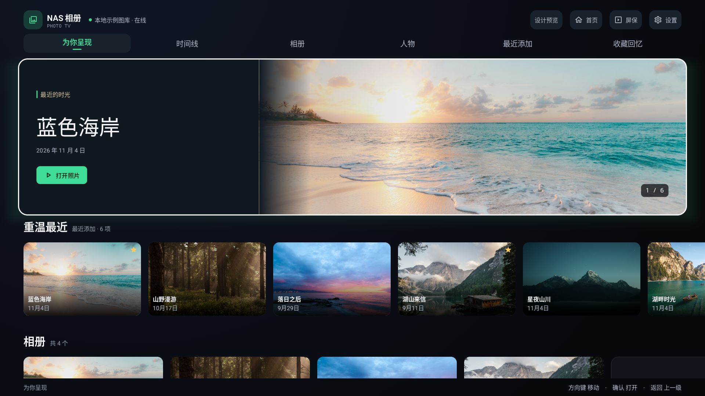
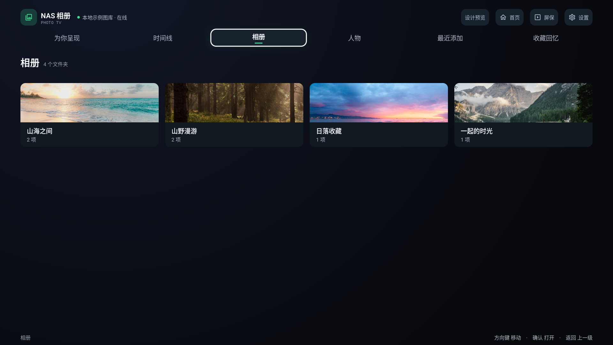
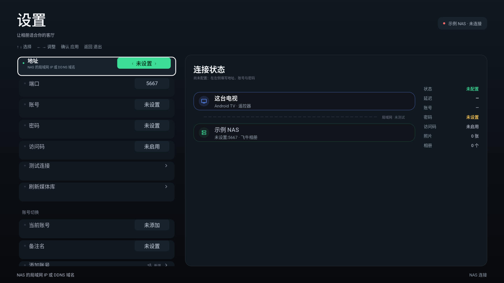

# NAS Photo TV · 客厅影廊

2026-11-04 · 基于 GitHub `main` 的 `b1f8df2`（1.1.2）。

> 本文保留早期影廊布局与验证记录。当前界面见 [2026-11-05 相册体验整改](../design-refinement-20261105/README.md)；中间一版见 [沉浸式影像首页](../design-immersive/README.md)。本文的六项导航和配色说明是历史状态。

本轮直接实现 Android 原生 Compose 界面。首页、相册卡片、媒体卡片、顶栏与设置已接入正式界面；离线示例入口仅打入 Debug 包。

## 原生界面预览

以下画面由通用 Android 模拟器运行本轮 Debug 包截取，使用独立示例数据。它们是实际 Compose 渲染；不代表已连接真实 NAS 或通过真电视验收。







常见电视逻辑画布的实际效果：[960×540 dp 首页](qa/07-home-960dp.png)、[960×540 dp 设置](qa/08-settings-960dp.png)。

## 设计方向

让电视成为浏览私人照片的影廊。主视觉将照片和信息分开：左侧日期、照片名和打开动作，右侧保留大幅照片；下方横向照片与相册继续浏览。保留极光青品牌色，减少大面积高亮和持续装饰动画。

```text
 NAS 相册    NAS 状态                    账号   首页  屏保  设置
 为你呈现       时间线       相册       人物       最近添加       收藏回忆
 ┌───────────────────────────────────────────────────────────┐
 │ 最近的时光            │                                    │
 │ 照片名称              │             照片舞台               │
 │ 拍摄日期              │                                    │
 │ [打开照片]            │                            1 / 6   │
 └───────────────────────────────────────────────────────────┘
 重温最近 · 最近添加
 [照片与标题]  [照片与标题]  [照片与标题]  [照片与标题]  ...
 相册
 [相册封面 + 名称/数量]  [相册封面 + 名称/数量] ...
 当前区域                       方向键 移动 · 确认 打开 · 返回 上一级
```

| 项目 | 实施选择 |
| --- | --- |
| 基础背景 | 深空黑 `#08090D` |
| 照片舞台 | 墨蓝 `#101820` |
| 功能表面 | `#17222C` |
| 品牌操作 | 极光青 `#3DDC97`，配深色文字 |
| 主文字 / 次文字 | `#F5F7FA` / `#A9B0BE` |
| 照片引导标签 | 柔和沙色 `#CDBA98` |
| 字体 | Android 系统无衬线中文；照片标题使用较轻字重，导航中等字重，序号等宽 |
| 焦点 | 单一白色 3dp 描边；普通卡片 1.05×、导航 1.025×、大型主视觉 1.015× |
| 布局 | 同时照顾 1920×1080 dp 与常见 960×540 dp；窄布局收起工具文字、缩小主视觉标题，设置长值换到下一行 |

通用设计技能的首次检索返回了面向网站作品集的 Portfolio Grid / Parallax Storytelling。电视端不适合依赖悬停、滚动视差和网页转化按钮，因此本轮仅采用其可读性、对比度与一致性检查；电视交互依据专项技能和 Android 官方资料。[技能调研与来源](skills-research.md)

## 已实现的行为

- 导航保持六类内容，缩短标签；已选择页面使用青色短线，遥控器当前焦点使用白描边，区分两个状态。
- 顶栏原“搜索”只是返回全部照片，这次准确标为“首页”；从详情进入首页时清除详情层级。
- 主视觉按上回当前导航，按下到最近照片；照片行左右浏览、上下跨行。首页保留各行焦点位置。
- 相册改为上方照片、下方名称和数量，避免文字持续盖住照片。照片标题常显，远距离更易辨认。
- 非首页的内容页按返回先回首页；详情、时间线的已有内部返回保持逐级处理。
- 设置采用明确的页标题、状态、两栏内容与中文按键提示；窄布局避免长地址挤掉标题。
- 沿用现有 NAS 连接、分页、账号、看图、播放器及屏保数据流。未增加网络/界面库依赖。

## 离线设计预览

Debug 专属入口：`com.nasphoto.tv/.DesignPreviewActivity`。使用示例摄影素材及独立偏好存储，在单独进程中运行，不读取真实 NAS 账号；正式 Release 不包含此入口和示例照片。

```powershell
adb install -r app/build/outputs/apk/debug/app-debug.apk
adb shell am start -n com.nasphoto.tv/.DesignPreviewActivity
adb shell am start -n com.nasphoto.tv/.DesignPreviewActivity --ei tab 2
adb shell am start -n com.nasphoto.tv/.DesignPreviewActivity --es screen settings
```

预览中的照片、账号名、人物和 NAS 在线标识都属于示例数据。实际截图、遥控器检查和构建结果见 [验收记录](qa/verification.md)，摄影出处见 [素材记录](qa/image-sources.md)。

## 文件入口

- `app/src/main/java/com/nasphoto/tv/ui/library/GalleryChrome.kt`：新版导航、照片舞台与按键提示。
- `app/src/main/java/com/nasphoto/tv/ui/library/LibraryComponents.kt`：卡片与视觉组件。
- `app/src/main/java/com/nasphoto/tv/ui/library/LibraryScreen.kt`：主内容组织、返回与焦点连接。
- `app/src/main/java/com/nasphoto/tv/ui/settings/`：设置布局、行焦点、值胶囊与连接摘要。
- `app/src/main/java/com/nasphoto/tv/ui/theme/Tokens.kt`：新增语义色与尺寸、收敛普通焦点缩放。
- `app/src/debug/`：独立离线预览和摄影样例资源。

这是未发布的界面改版。构建、通用 Android 模拟器表现、真实电视遥控器体验与真实 NAS 连接分别验收；本轮不以示例预览代表电视实测。
