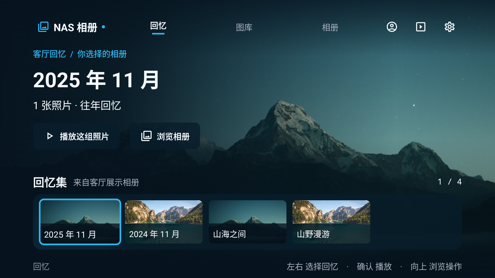
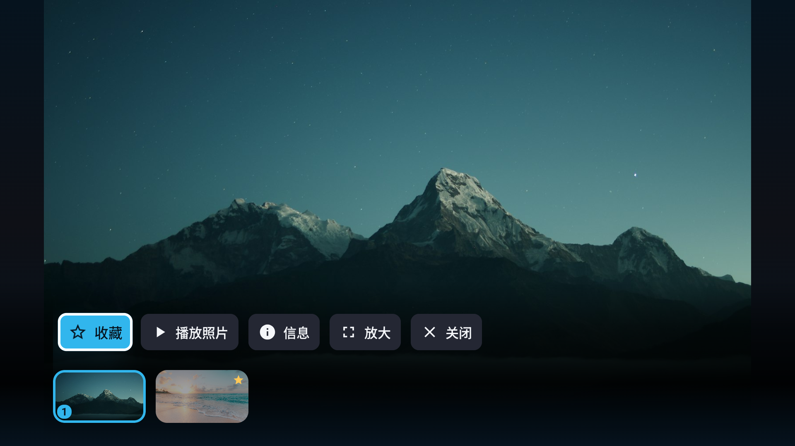

# NAS Photo TV · 相册体验整改

2026-11-05。本轮沿用深海蓝 / 冰蓝视觉，将电视相册的浏览、回看和客厅展示分开。

可对外发布的[新版设计说明、六张配图和发帖说明](../promotion/design-preview-20261105/README.md)已单独整理，便于论坛和社区使用。

## 已实现

- 顶部入口收敛为「回忆、图库、相册」。人物和收藏移到相册内；小逻辑画布的相册与照片网格降低列数。
- 回忆首页展示用户授权相册与往年日期回忆；以相册名称、日期范围、照片数量作标题，确认即可播放这组照片。原始文件名保留在看图详情中。
- 竖图与未知尺寸照片保留原比例。首页的大背景、回忆集合及屏保只从明确授权的相册中取图。
- 新增「设置 → 屏保与待机 → 客厅展示相册」，支持逐相册勾选和全部取消。授权与当前账号、NAS 身份绑定；正常图库浏览不受该展示范围限制。
- 新安装默认关闭自动屏保。保留用户已有的显式开关值，但没有授权照片时不会自动播放照片屏保；指定空相册、已删除相册或人物来源无结果均不回退最近照片。
- 看图器初始显示照片，标题和日期按需短暂出现；紧凑工具条提供收藏、播放、信息、缩放与关闭，支持横向滚动。查看器保留照片原比例、返回位置与放大平移。
- 相册播放可自动启动幻灯片；普通图库打开单张照片仍采用手动浏览。





## 预览与验证

离线 Debug 入口沿用 `com.nasphoto.tv/.DesignPreviewActivity`，与正常账号存储隔离。示例默认明确授权部分相册，另留未授权相册用于检查展示范围。

```powershell
adb install -r app/build/outputs/apk/debug/app-debug.apk
adb shell am start -n com.nasphoto.tv/.DesignPreviewActivity
```

验证范围、实际截图和遥控器结果见 [验证记录](qa/verification.md)，构建产物摘要见 [build-summary.json](qa/build-summary.json)。离线示例与正常账号存储隔离，不连接真实 NAS。

方向键移动，确认打开，返回退出。首页从胶片条向上到播放按钮，再向上到主导航；相册导航按确认后，向下进入「相册 / 人物 / 收藏」。看图时左右翻图，向下进入工具，向上回到照片；幻灯片播放时方向键暂停。

摄影素材沿用[上一轮示例及许可](../design-next/qa/image-sources.md)。[沉浸式首页历史记录](../design-immersive/README.md)保留供对照。
