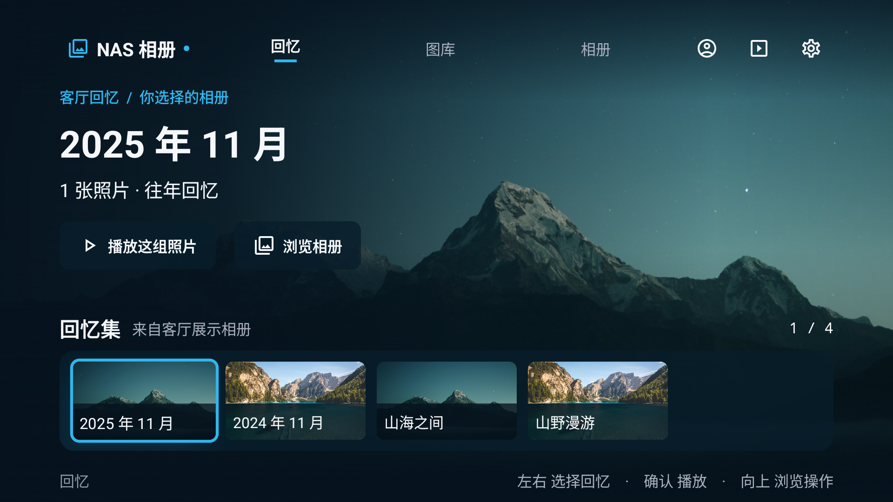

# NAS Photo TV · 新版设计发布素材

2026-11-05，适用于论坛、社区和社交平台的设计预览介绍。

- [新版设计说明 / 论坛完整稿](论坛发布稿.md)
- [论坛外链版](论坛外链版.md)
- [短版社交文案](短版文案.md)
- [发帖说明](发帖说明.md)
- [图片来源](图片来源.md)
- [构建与素材记录](素材记录.json)

这次改版包含三项主导航、相册与日期回忆集合、按需显示的看图工具，以及客厅展示相册选择。彩色相册花图标是独立设计稿。当前内容为开发设计预览，具体实现和验证范围见[设计记录](https://github.com/SMTM-PH/NasPhotoTV/blob/ca088c226f5256ded9dba30428c0f481efe6b712/docs/design-refinement-20261105/README.md)。
