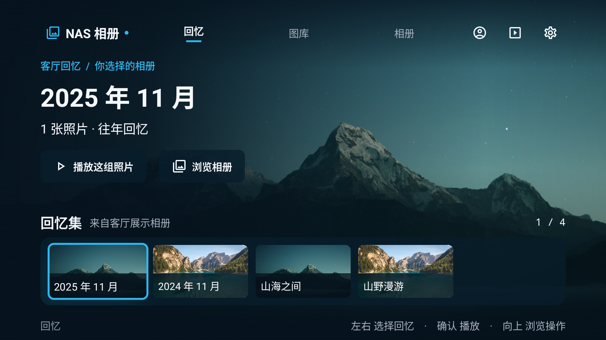
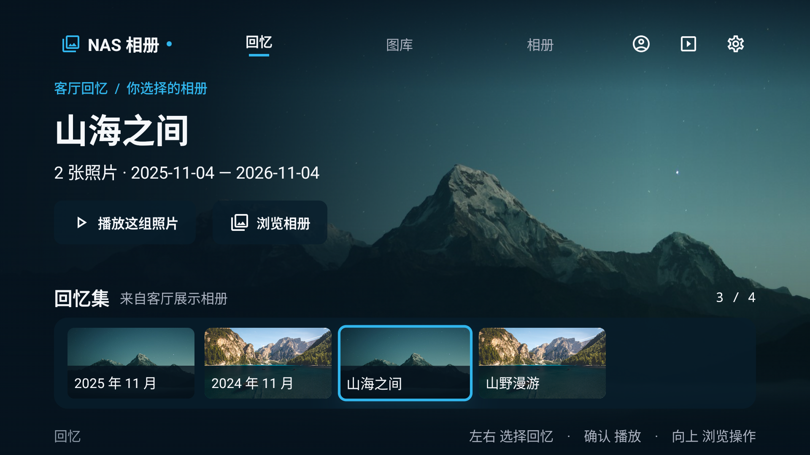
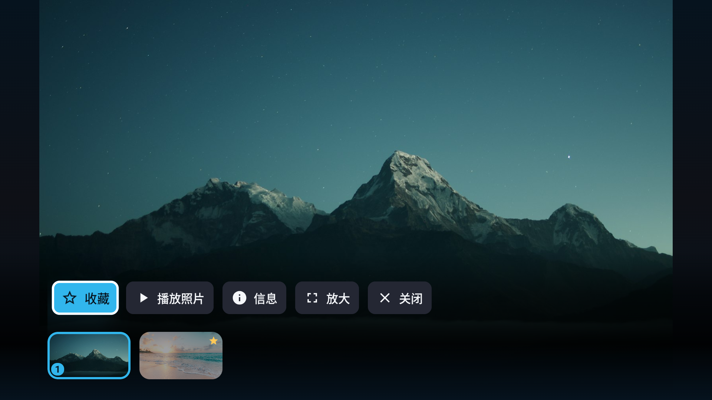
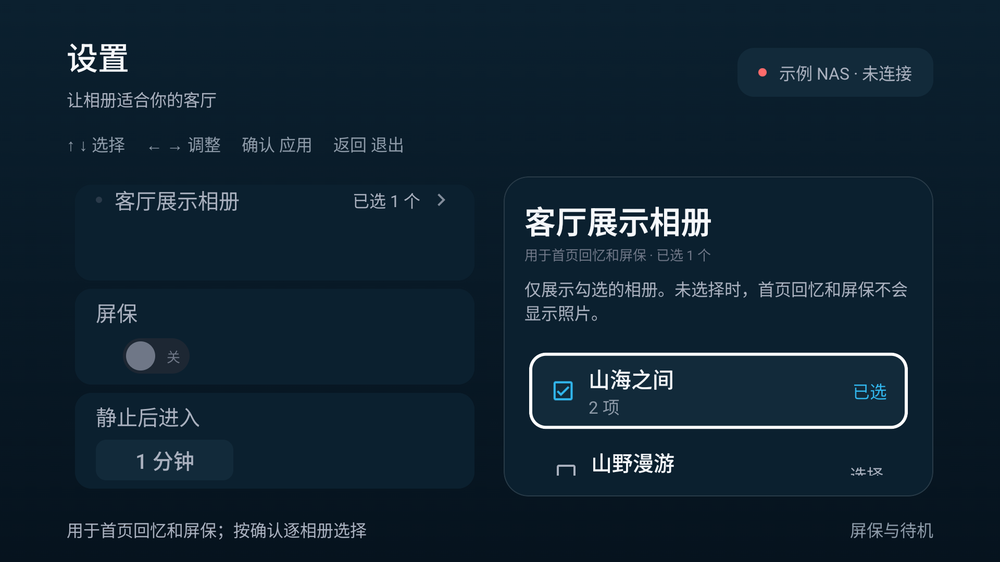
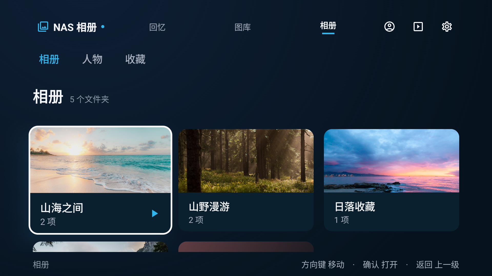

# NAS Photo TV 新界面预览：让 NAS 里的相册，回到客厅大屏

照片备份到 NAS 以后，很多时候就很少再打开了。一直想做一个适合坐在沙发上、拿着遥控器慢慢翻的相册，也方便家人一起看看以前的旅行和日常。

这是我的个人项目 **NAS Photo TV**，一个面向 Android TV / 电视盒子的**非官方飞牛相册客户端**。最近重新整理了界面和操作，分享这版 **开发设计预览**，也想听听大家对电视相册的想法。

先说明当前进度：本文展示的是开发中的界面改版，尚未作为新正式版本发布。界面配图来自普通 Android 模拟器中的离线示例图库；本轮还没有复验真实电视和真实 NAS，实际设备上的连接、遥控器体验与兼容性仍需要继续验证。

## 首页先看到回忆，入口少一点

主导航收敛成了「回忆、图库、相册」。想随意回看就进回忆，想找某张照片就进图库，想按自己整理的目录浏览就进相册。人物和收藏也收到了相册里。

首页用大幅照片做背景，左侧显示相册或回忆集合的名称、日期范围和照片数量，下方是一排可以左右浏览的集合。标题尽量用相册名称和日期，让人一眼知道即将打开什么；原始文件名仍然可以在照片信息里查看。

*界面配图为离线示例，照片分组、数量和日期用于展示设计。*

## 选一组照片，坐下来慢慢看

回忆页会从允许展示的相册中，按往年日期整理照片集合，也保留相册入口。选中一组后按确认，就能开始播放这一组照片。

比如打开一个旅行相册，就按这组照片继续播放；返回以后，仍停留在刚才选中的集合，方便接着往下找。这里的回忆按日期和相册整理。

## 看图时，把屏幕留给照片

打开照片后，先看到完整画面，信息和操作按需出现。左右键翻照片，向下呼出工具，向上回到照片；播放幻灯片时，方向键可以暂停。

工具条只保留常用的五项：收藏、播放、信息、放大和关闭。普通图库打开单张照片时仍然手动浏览，播放相册时则可以直接开始幻灯片。照片保留原比例，想看细节时也可以放大和平移。

## 哪些照片出现在客厅，由自己选择

这一版增加了「设置 → 屏保与待机 → 客厅展示相册」。可以用遥控器逐个勾选，也可以全部取消，选定数量会直接显示。

**首页回忆和照片屏保，只使用明确选中的展示相册。** 没有选择、相册为空或已被删除时，不会再拿其他最近照片补上。这个选择只控制客厅展示，正常进入图库仍可以浏览当前账号的全部内容。

展示选择与账号、NAS 身份绑定；切换账号不会继承另一个账号的展示授权，更换 NAS 地址或用户名后也需要重新选择。

新安装默认关闭自动屏保，已有用户的显式开关选择会保留。需要时可以手动开启应用内屏保；进入「预览屏保」本身不会打开自动屏保开关。

## 相册、人物和收藏，放在一起找

相册页保留清楚的封面、名称和数量，人物、收藏通过页内分类进入。在画面空间较小的设备上，网格会减少列数，让照片和文字有足够空间。

界面继续围绕遥控器设计：方向键移动、确认打开、返回上一级。回到列表时，尽量留在刚才浏览的位置。

## 新图标也在尝试中

另外做了一张彩色相册花的图标草案，用白底和彩色叠层表达相册的感觉。这张图标由 AI 辅助生成并迭代，**目前是独立设计稿，尚未接入 APK**。

## 项目与体验入口

项目主页：[SMTM-PH / NasPhotoTV](https://github.com/SMTM-PH/NasPhotoTV)

本轮设计与代码：[界面设计预览分支](https://github.com/SMTM-PH/NasPhotoTV/tree/codex/tv-gallery-ui)

想自行构建、安装体验，可以查看[该分支的 README](https://github.com/SMTM-PH/NasPhotoTV/blob/codex/tv-gallery-ui/README.md)。这次分享的是设计预览，安装方式和后续更新以项目说明为准。

目标设备是 Android 8.0 及以上的 Android TV 或兼容盒子，使用自己的飞牛 NAS 和相册账号。愿意尝试的朋友，可以先关注这一版界面；真实设备上的照片、视频和网络体验，也欢迎之后一起反馈。

我最想听听大家日常会怎么用电视相册：更常按相册回看，还是按日期找照片？首页这排回忆集合是否直观，看图时的操作是否够简单？有设备体验反馈的话，附上电视或盒子型号、Android 与 fnOS 版本，会更方便定位问题。
